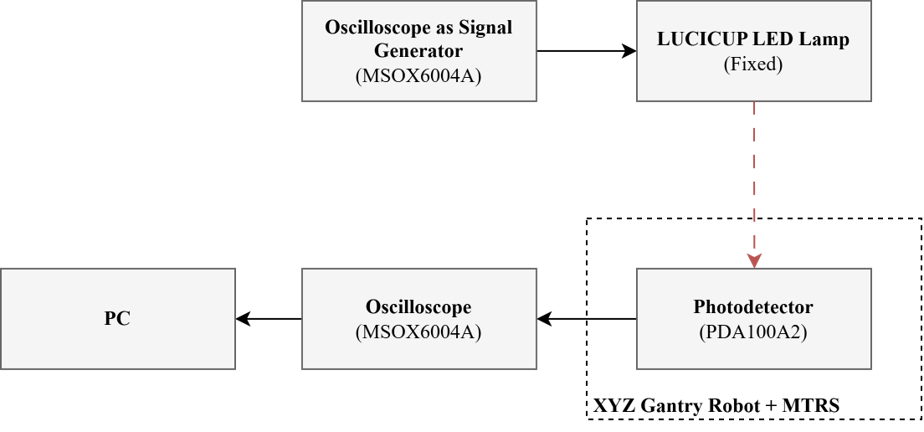

# Database Acquisition Tool — Visible Light Positioning Testbed

Software to build **received-signal databases** for visible light positioning (VLP) research.
A photodetector mounted on an XYZ gantry robot and a motorized rotation stage is moved
automatically through a 3D grid of positions and receiver orientations. At every pose, the
oscilloscope records the photodetector signal and the tool stores the amplitude of each LED
(identified by its modulation frequency), the spectrum and the raw waveform.

The tool is part of an experimental testbed for this research question: *under which conditions
can full 3D positioning be achieved with a fixed optical anchor and a single, actively
reorientable photodiode, using controlled receiver-orientation diversity?* The databases it
produces are meant for fingerprinting, model fitting and the later randomized evaluation of
positioning methods.

Main features:

- Browser-based interface: grid and orientation set-up, plan preview with duration and
  disk-space estimate, live 3D/top view of the receiver, live FFT, pause / resume / stop.
- Synchronized control of the gantry, the rotation stage (MTRS) and the oscilloscope from a
  single Python process. The device parameters live in one configuration file.
- Cable-safe, time-efficient route: serpentine XY order, alternating angle order, the 0°/360°
  boundary is never crossed, and passes can be repeated to measure repeatability.
- Long continuous records (e.g. 100 ms at 10 MSa/s = 10 Hz frequency resolution). The program
  configures the oscilloscope temporarily and restores your settings afterwards.
- Compact `points.csv` (one row per measurement) plus the full spectra and lossless raw
  waveforms, which allow any analysis to be redone later.
- **Simulation mode**: every device has a simulated twin, so the software can be tried without
  any hardware.

---

## 1. System overview



| Block | Equipment | Role | Interface to the PC |
|---|---|---|---|
| Signal generator | Oscilloscope with built-in waveform generator | Modulates each LED at its own frequency | — (stand-alone) |
| Transmitter | LUCICUP LED lamp, **fixed** | Optical anchor: 4 LEDs at 4 frequencies | — |
| Receiver | Thorlabs **PDA100A2** amplified photodetector (gain 20 dB) | Converts light to voltage | Coaxial cable to CH1 of the oscilloscope |
| Receiver orientation | Thorlabs **MTRS** motorized tilt & rotation stage, PD on a 3D-printed adapter tilted 15° | Azimuthal orientation diversity; the motorized tilt stays at 0° | USB, Thorlabs Kinesis (.NET) |
| Receiver position | igus **DLE-RG-0012-BLDC** XYZ room gantry | Cartesian position X, Y, Z | Ethernet, CRI protocol (`cri_lib`) |
| Acquisition | Agilent/Keysight InfiniiVision **MSO-X 4154A** oscilloscope | Digitizes the PD signal | USB, VISA (`pyvisa`) |
| Control | Windows PC | Runs this software | — |

LED layout of the lamp and modulation frequencies, seen from below:

```
   300 kHz    900 kHz
   500 kHz    700 kHz
```

Coordinate conventions (also shown in the interface):

- Gantry workspace: X 0–1400 mm, Y 0–1400 mm, Z −700–0 mm.
- **Z = −700 mm is the highest PD position (closest to the lamp) and Z = 0 the lowest.**
  The views draw Z accordingly (`[view] z_negative_up = true`).
- Orientation k of K: `angle_k = (offset + 360·k/K) mod 360`, which is the MTRS rotation
  angle. With the default offset of 65° and K = 4, the angles are 65°, 155°, 245° and 335°.
- `pd_tilt_deg` (15°) is the **mechanical** tilt of the 3D-printed adapter. It is only
  recorded; the motorized MTRS tilt is never moved.

---

## 2. Repository structure

```
database_acquisition/
├── README.md
├── requirements.txt
├── app/                        # the application
│   ├── run.py                  # launcher  <- start here
│   ├── engine.py               # plan, motion, acquisition, saving (all the logic)
│   ├── server.py               # local HTTP + Server-Sent Events API
│   └── web/                    # browser interface (HTML/CSS/JS, no external dependencies)
├── hardware/                   # reusable device drivers (independent of the application)
│   ├── testbed.py              # Testbed: builds/connects the devices from the config
│   ├── gantry.py               # igus gantry (CRI)
│   ├── mtrs.py                 # Thorlabs MTRS (Kinesis .NET)
│   ├── scope.py                # Keysight oscilloscope (VISA) + signal-processing helpers
│   ├── sim.py                  # simulated gantry / MTRS / oscilloscope
│   └── utils.py
├── config/
│   └── testbed.toml            # ALL device parameters (addresses, limits, speeds, conventions)
├── docs/
│   └── block_diagram.png
└── data/                       # created at run time; one folder per session (git-ignored)
```

`hardware/` can be reused by any other experiment (add the repository root to `sys.path`):

```python
from hardware.testbed import Testbed

with Testbed() as tb:                           # reads config/testbed.toml and connects
    tb.go_to_pose((700, 700, -300), 155)        # gantry + MTRS together, waits for arrival
    acqs = tb.scope.record(1, 8_000_000)        # one synchronized acquisition
```

---

## 3. Requirements

**Software (lab PC)**

- Windows 10/11 (Thorlabs Kinesis is Windows-only).
- Python ≥ 3.11 (tested with 3.13).
- [Keysight IO Libraries Suite](https://www.keysight.com/find/iosuite), which provides the VISA
  library used by `pyvisa`.
- [Thorlabs Kinesis](https://www.thorlabs.com/software_pages/ViewSoftwarePage.cfm?Code=Motion_Control),
  installed in `C:\Program Files\Thorlabs\Kinesis` (path configurable).
- igus Robot Control (iRC), to reference the gantry and for the emergency stop.
- A modern web browser.

The simulation mode only needs Python and the packages in `requirements.txt`.

**Network**: the gantry controller is at `192.168.3.11:3920` by default; the PC needs an
address in the same subnet.

---

## 4. Installation

```bash
git clone <this repository>
cd <repository>
python -m venv .venv
.venv\Scripts\activate            # Windows
pip install -r requirements.txt
```

`requirements.txt` installs `cri_lib` directly from the Commonplace Robotics GitHub
repository, pinned to the tested commit.

### Try it without hardware

```bash
python app/run.py --sim
```

The interface opens at <http://127.0.0.1:8765>. Every device is simulated: the gantry and the
MTRS move faster than the real ones, and the oscilloscope produces a physically plausible
signal from four Lambertian LEDs. The duration estimates still use the real hardware speeds.

---

## 5. Set-up before a measurement campaign

Do these steps once per campaign and **do not change the settings during the campaign**, so
that all the data stays comparable.

### 5.1 Devices

1. **Gantry**: switch it on, check that the emergency-stop circuit is OK and reference the
   axes in iRC. The program refuses to move an unreferenced robot.
2. **MTRS**: home both channels (rotation and tilt) in Kinesis, then **close Kinesis**; only
   one program can hold the device at a time.
3. **Photodetector (PDA100A2)**: gain **20 dB**, connected to **CH1**.
4. **LED lamp / generator**: each LED modulated at its frequency (300, 500, 700 and 900 kHz).
5. Close any other program that uses the oscilloscope (Keysight Interactive IO, BenchVue,
   other scripts).

### 5.2 Oscilloscope

| Setting | Recommended value | Who sets it |
|---|---|---|
| CH1 (photodetector) vertical scale | **75 mV/div** (±300 mV on screen) | You, fixed for the whole campaign |
| CH1 coupling | AC is typical; keep the same for the whole campaign | You |
| Other channels | Off (two active channels halve the available memory) | You |
| Acquisition mode | Normal | You |
| Math → FFT on CH1 | **Configured and visible**; e.g. 5 mV/div, 0–1 MHz (centre 500 kHz, span 1 MHz) | You |
| Digitizer mode, sample rate | 10 MSa/s (the "Sample rate" field) | The program |
| Timebase / record length | Record length / 10 per division (e.g. 100 ms → 10 ms/div) | The program |
| Trigger sweep | Auto (restored on exit) | The program |

Important notes:

- **The vertical scale must contain the signal at the strongest position of the whole
  campaign.** The signal must never saturate, but it should still use a good part of the
  screen. Check the strongest position (closest to the lamp, PD facing it) before starting. The
  `clip_frac` column of `points.csv` flags any saturated sample.
- **The FFT frequency resolution is set by the record length, not by the FFT zoom**:
  Δf = 1 / T (5 ms → 200 Hz, 100 ms → 10 Hz). Changing the span or centre of the FFT on the
  screen does not change the bin size. The FFT span only defines the frequency band stored in
  `fft/*.csv`.
- The program never sends `*RST` or `:AUToscale`, so the waveform generator outputs are left
  untouched.
- During a session the oscilloscope FFT is hidden. Otherwise the instrument would recompute
  it after every capture, adding ~1.4–2 s per sample. The program computes the FFT in Python
  over the full record and shows it in the interface. Your timebase, sample rate, memory and FFT
  display are restored when the session ends, when you press Stop or when you press Ctrl+C.

### 5.3 Configuration file

Check `config/testbed.toml` once per set-up: oscilloscope VISA address, gantry IP, workspace
limits, speeds (`velocity_mm_s`, `velocity_deg_s`) and view orientation. Every field is
commented. Applications never duplicate these values.

---

## 6. Running an acquisition

```bash
python app/run.py            # real devices
python app/run.py --help     # --sim, --port, --no-browser, --output
```

1. **Configure** in the left panel (the ☰ Configuration button collapses it):

   | Group | Field | Meaning |
   |---|---|---|
   | Grid | X, Y, Z start / end / step [mm] | Positions; a step that does not reach the end is reported |
   | Orientation | K (angles) | Number of orientations per position (K = 1 → a single one) |
   | | Offset [deg] | Angle of the first orientation (default 65°) |
   | | PD tilt [deg] | Mechanical tilt of the adapter, **recorded only** |
   | LEDs | Number of LEDs, frequency of each [kHz] | One group of columns per LED in `points.csv` (e.g. `700kHz_wave_Vrms`) |
   | Acquisition | Samples / orient. | Consecutive records at the same pose (short-term noise) |
   | | Passes | Repetitions of the whole route; odd passes run in reverse (repeatability) |
   | | Settle [s] | Wait after arriving and before measuring |
   | | Record length [ms], Sample rate [MSa/s] | One continuous record per sample (0 ms = keep the oscilloscope settings) |
   | | Also read the oscilloscope FFT | Only for short records (≤ 62,500 points); slower |
   | | Serpentine XY / Alternate angle order | Efficient, cable-safe route (recommended) |
   | | Save raw waveforms | `wave/*.npz` (~0.6 MB per 100 ms sample) |
   | | Session label | Optional suffix of the session folder |

2. **Preview plan**: the program validates the plan (workspace, Nyquist, oscilloscope memory)
   and shows the route, the number of measurements, the estimated duration with a breakdown
   (rotation, gantry, settling, acquisition) and the disk space. With the real oscilloscope it
   measures one acquisition to make the estimate accurate.
3. **Start**. Positions turn green as they are completed, and the map can be coloured by the RSS
   of any LED. **Pause** takes effect after the current measurement, **Resume** continues and
   **Stop** halts the motion immediately. If a measurement fails, the acquisition pauses and the
   reason is shown in the log; invalid data is never saved.
4. Closing the browser does not stop the session: just open the URL again. To quit, press
   **Ctrl+C** in the console. This stops any motion, restores the oscilloscope and closes the
   devices.

Typical timing on the real testbed: MTRS 1.5 °/s (a 90° step takes ~62 s, which dominates when
K > 1), gantry 50 mm/s (300 mm in ~6.7 s), and one 100 ms acquisition ~1.2 s.

---

## 7. Output data

Every session creates `data/session_<YYYYmmdd_HHMMSS>[_label]/`:

| File | Content |
|---|---|
| `points.csv` | **Main table**: one row per measurement (position × orientation × pass) |
| `fft/mNNNNN.csv` | Spectrum of every sample (≤ 4000 bins, peaks preserved), header with pose and settings |
| `wave/mNNNNN.npz` | Raw waveform of every sample, lossless ADC codes |
| `plan.csv` | Every planned measurement, in execution order |
| `trajectory.csv` | Gantry and MTRS telemetry at 10 Hz during the whole session |
| `session.json` | Plan configuration, device information, oscilloscope settings, timing model, final status |
| `README.txt` | Description of the columns, written into every session |

Main columns of `points.csv`:

| Column | Description |
|---|---|
| `meas_id`, `pass`, `site_id`, `ix`, `iy`, `iz`, `k` | Measurement, pass, grid position and angle indices |
| `x_cmd_mm` … `angle_cmd_deg` | Commanded pose |
| `x_mm`, `y_mm`, `z_mm`, `angle_deg` | Measured pose (device feedback) |
| `mtrs_tilt_deg`, `pd_tilt_deg` | Motorized tilt (≈ 0) and mechanical adapter tilt |
| `<f>kHz_wave_Vrms` | **RSS of the LED at f**: RMS amplitude of the f sinusoid over the whole record (lock-in projection). Recommended value |
| `<f>kHz_fft_Vrms` | Peak of the FFT near f (diagnostic) |
| `*_std` | Standard deviation over the samples (when samples > 1) |
| `clip_frac` | Fraction of saturated samples (should be 0) |
| `wave_ac_rms_V` | Total RMS of the waveform (signal + noise) |
| `fft_file`, `wave_file` | Relative paths of the files of that measurement |

To get the variance of every pose, group by `(site_id, k)` across passes.

Loading the data in Python:

```python
import numpy as np, pandas as pd

points = pd.read_csv("data/<session>/points.csv")

z = np.load("data/<session>/wave/m00001.npz")
v = ((z["codes"] - z["y_reference"][:, None]) * z["y_increment"][:, None]
     + z["y_origin"][:, None])                  # volts, shape (samples, points)
t = np.arange(v.shape[1]) / z["fs"]             # seconds
```

Disk usage with waveforms is ~0.7 MB per measurement for 100 ms records (1,000 measurements
≈ 0.7 GB). Keep `data/` out of git; it is ignored by default.

---

## 8. Signal-processing notes and known limitations

- `<f>kHz_wave_Vrms` and `<f>kHz_fft_Vrms` come from the **same** samples. Their agreement
  (typically within 1 %) confirms that the processing is consistent, but it is not an
  independent physical validation.
- The amplitudes are evaluated at the **configured (nominal) LED frequencies**. The LED
  generators of this testbed were measured to be about 1 ppm off nominal
  (299 999.654 / 499 999.456 / 700 000.834 / 900 000.984 Hz). With 100 ms records, this makes
  `wave_Vrms` read 0.2 / 0.5 / 1.1 / 1.6 % low. The offset is constant for a given set-up and
  can be corrected at the analysis stage from the stored raw waveforms.
- With the oscilloscope Math FFT active, the MSO-X 4154A shortens long records (~62,500
  points). The program therefore only allows reading the oscilloscope FFT for short records.
  It checks every record (length and sample rate) and refuses to save a measurement that could
  be aliased.
- The vertical resolution is not the limiting factor: averaging 10⁶ samples, the noise floor
  is a few µVrms per 10 Hz bin, against LED amplitudes of the order of mV.

---

## 9. Safety

- The gantry completes every accepted move even if the connection drops. Keep the emergency
  stop (or the iRC Stop button) at hand, and keep the work volume clear.
- The program only moves inside the workspace box of `config/testbed.toml`, and only if the
  robot is referenced and the E-stop circuit is OK.
- The MTRS operates in `LinearRange` (0–360°) and never crosses 360°, so the photodetector cable
  cannot wind up.

---

## 10. Troubleshooting

| Symptom | Cause / fix |
|---|---|
| `[Scope] Could not open ... VI_ERROR_IO` / `NCIC` | Another program holds the oscilloscope (Interactive IO, BenchVue, another script). Close it and retry. |
| `No Math function with a visible FFT` | Set Math → FFT on CH1 and make it visible before starting. |
| `[MTRS] Not found` | Kinesis is open, or the USB cable is disconnected. Close Kinesis. |
| `[MTRS] Not homed` | Home both channels in Kinesis, then close it. |
| `[Gantry] Robot not referenced` / `E-stop circuit is not OK` | Reference in iRC / release the emergency stop. |
| Plan rejected: memory / Nyquist / oscilloscope FFT | Shorten the record, lower the sample rate or disable "Also read the oscilloscope FFT". |
| Oscilloscope left at 10 ms/div with the FFT hidden | The program was killed abruptly. Restore your timebase, sample rate and memory, and show the FFT again (Math menu). |
| Port 8765 busy | The next free port is used automatically, or use `--port`. |
